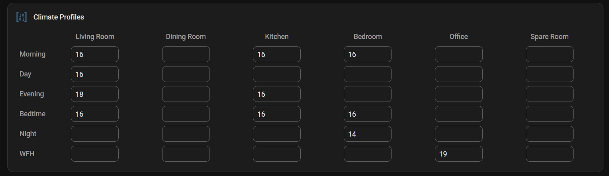
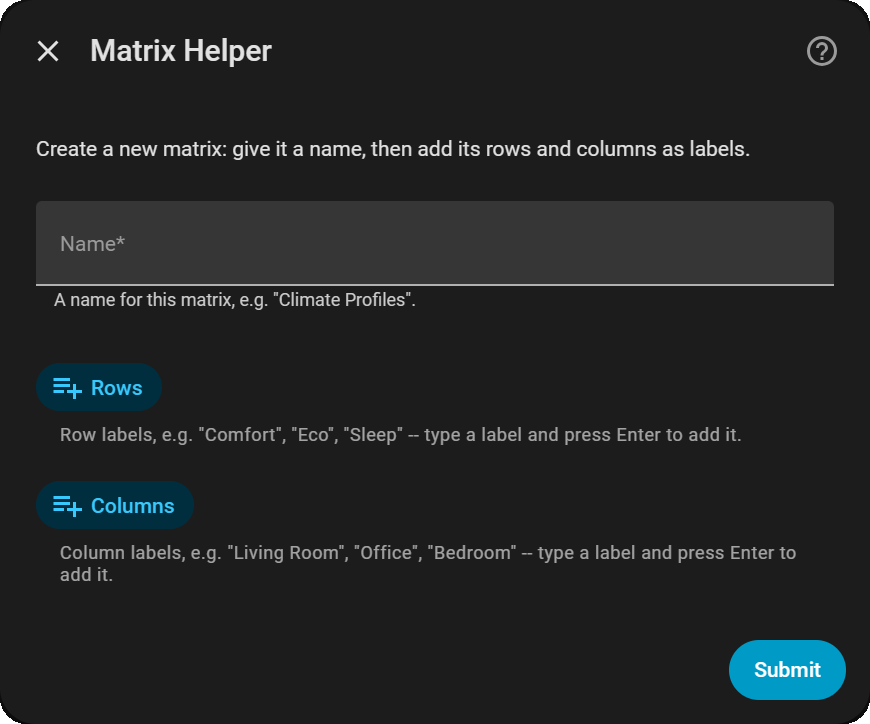
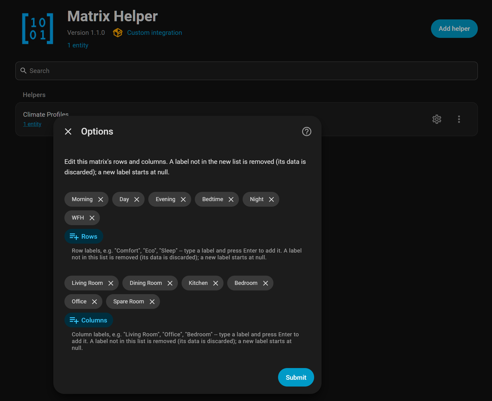
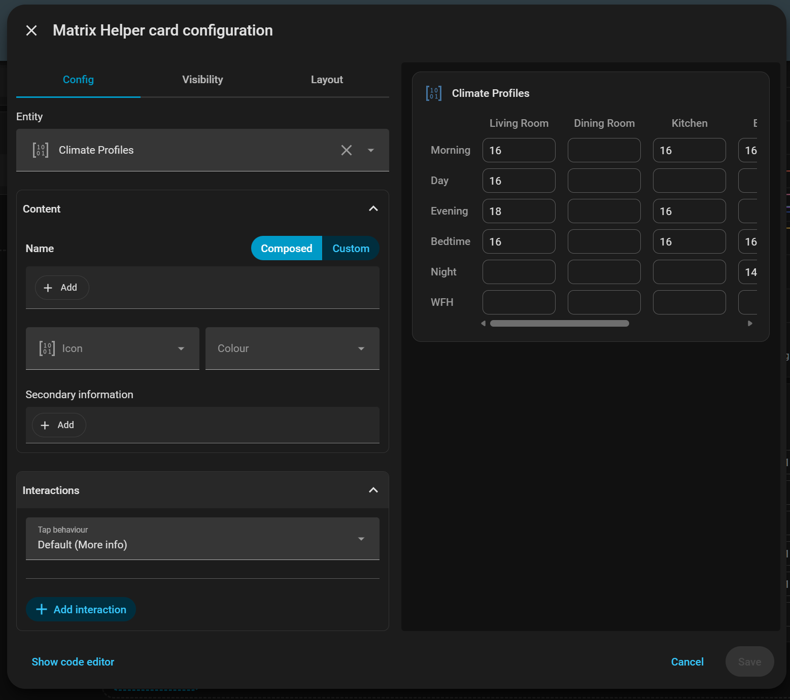

# Matrix Helper

A Home Assistant helper that holds a **2D table of numbers** — rows × columns of
numeric-or-empty cells — in a single entity you can edit from the UI and read from
any automation, script or template.

The motivating use case is climate profiles: rows are profiles (Comfort, Eco,
Sleep), columns are rooms, and each cell is that room's target temperature for that
profile. A schedule-driven automation then looks up `data[profile][room]` instead of
you maintaining dozens of `input_number` helpers. It's deliberately generic, though:
anything that's naturally a lookup table (lighting levels per scene and room, price
thresholds per hour and day, …) fits.

It comes with a dashboard card for editing the values, ready to use as soon as the
integration is installed.



## Installation

### HACS (recommended)

[](https://my.home-assistant.io/redirect/hacs_repository/?owner=danielmsorensen&repository=ha-matrix-helper&category=integration)

Search for **Matrix Helper** in HACS, download it, and restart Home Assistant.

If it isn't listed yet, add it as a custom repository first: HACS → ⋮ →
**Custom repositories** → add `https://github.com/danielmsorensen/ha-matrix-helper`
with type **Integration**.

### Manual

Copy `custom_components/matrix_helper` into your Home Assistant `config/custom_components/`
folder and restart Home Assistant.

## Creating a matrix

[](https://my.home-assistant.io/redirect/config_flow_start/?domain=matrix_helper)

Settings → Devices & services → **Helpers** → **Create helper** → **Matrix Helper**.
Give it a name, then type each row and column label and press Enter to add it.
There's no limit on the number of rows or columns.



Each matrix becomes one entity, e.g. `matrix_helper.climate_profiles`. All cells
start empty.

### Changing rows and columns later

Settings → Devices & services → **Matrix Helper** → **Configure** on the matrix you
want to change. Add, remove or reorder labels:

- Cells in rows/columns you keep are preserved.
- A removed label's cells are discarded; a new label's cells start empty.
- Changing a label's text counts as removing the old one and adding a new one, so
  its values are not carried over.



## Dashboard card

The integration includes a card for editing a matrix on a dashboard, and adds it to
your dashboard resources itself. There's nothing else to install.

Edit a dashboard → **Add card** → search for **Matrix Helper**. It's also suggested
when you add a card for a matrix entity. Or in YAML:

```yaml
type: custom:matrix-helper-card
entity: matrix_helper.climate_profiles
```

- **Editing:** type a value in any cell and press Enter, or click away. Empty a cell to
  clear it, or press Escape to cancel. Both `21.5` and `21,5` work.
- **Any size:** a large matrix scrolls inside the card, with its row and column labels
  kept in view. In sections dashboards, set a fixed height from the card's **Layout**
  tab and the grid scrolls within it.
- **The usual options:** name, icon, colour and secondary information, plus tap, hold
  and double-tap actions (More info by default), all from the visual editor.



**Upgrading from the separate Matrix Helper Card?** The card used to be its own HACS
download. It's now built in, so remove the old one in HACS: open **Matrix Helper
Card**, then ⋮ → **Remove**. Home Assistant shows a repair notice until you do. Your
existing cards keep working without changes.

## The entity

The entity's **state** is the time the matrix was last changed, so a state trigger
on it fires whenever any cell changes. The table itself is in its attributes:

| Attribute       | Example                                        |
| --------------- | ---------------------------------------------- |
| `rows`          | `["comfort", "eco", "sleep"]`                  |
| `columns`       | `["living_room", "office"]`                    |
| `row_labels`    | `["Comfort", "Eco", "Sleep"]`                  |
| `column_labels` | `["Living Room", "Office"]`                    |
| `data`          | `{"comfort": {"living_room": 21.0, "office": null}, ...}` |

`rows`/`columns` are the **keys** — the labels in lowercase with spaces replaced by
`_` (`Living Room` → `living_room`). Use keys when reading `data` in templates.
Every action accepts either the key or the original label.

Values are stored as numbers (`21` becomes `21.0`); an empty cell is `null` in
`data` (`none` in templates).

## Reading values in templates

```jinja
{# One cell #}
{{ state_attr('matrix_helper.climate_profiles', 'data')['comfort']['living_room'] }}

{# With a fallback for an empty cell #}
{{ state_attr('matrix_helper.climate_profiles', 'data')['comfort']['living_room'] | default(18, true) }}

{# A whole row, as a mapping of column key -> value #}
{{ state_attr('matrix_helper.climate_profiles', 'data')['eco'] }}
```

## Actions

All actions target one or more `matrix_helper` entities and are available in the
automation/script editor. Changes are **atomic**: if any row or column in a call
doesn't exist, nothing is changed and you get an error listing the valid keys.
Calls that wouldn't change any cell don't update the entity at all.

| Action                     | What it does                                                        |
| -------------------------- | ------------------------------------------------------------------- |
| `matrix_helper.set_cell`   | Set one cell. Leave `value` out to clear it.                        |
| `matrix_helper.set_row`    | Set some or all cells in one row.                                   |
| `matrix_helper.set_column` | Set some or all cells in one column.                                |
| `matrix_helper.set_values` | Set any cells across any rows, as `{row: {column: value}}`.         |
| `matrix_helper.fill`       | Set every cell — or every cell in a row and/or column — to a value. |
| `matrix_helper.adjust`     | Add an amount to every non-empty cell, optionally within a row/column. |

In `set_row`, `set_column` and `set_values`, use `null` as a value to clear a cell.

```yaml
# Set one cell
action: matrix_helper.set_cell
target:
  entity_id: matrix_helper.climate_profiles
data:
  row: Comfort
  column: Living Room
  value: 21.5

# Set several rooms in the Eco profile; other rooms are untouched
action: matrix_helper.set_row
target:
  entity_id: matrix_helper.climate_profiles
data:
  row: eco
  values:
    living_room: 18
    office: null

# Update cells across several profiles at once
action: matrix_helper.set_values
target:
  entity_id: matrix_helper.climate_profiles
data:
  values:
    comfort: { living_room: 21, office: 20 }
    sleep: { living_room: 17 }

# Set every room in the Sleep profile to 16
action: matrix_helper.fill
target:
  entity_id: matrix_helper.climate_profiles
data:
  row: sleep
  value: 16

# Winter mode: one degree warmer everywhere
action: matrix_helper.adjust
target:
  entity_id: matrix_helper.climate_profiles
data:
  amount: 1
```

`fill` without a `value` clears the cells, e.g. `fill` with only `column: office`
empties the Office column.

## Example: applying a profile

A script that sets every room's thermostat from one row of the matrix, skipping
rooms with an empty cell. It assumes each column key matches a `climate.` entity
(e.g. column `living_room` → `climate.living_room`).

```yaml
alias: Apply climate profile
fields:
  profile:
    example: comfort
sequence:
  - variables:
      targets: "{{ state_attr('matrix_helper.climate_profiles', 'data')[profile] }}"
  - repeat:
      for_each: "{{ targets | dictsort | selectattr(1, 'ne', none) | list }}"
      sequence:
        - action: climate.set_temperature
          target:
            entity_id: "climate.{{ repeat.item[0] }}"
          data:
            temperature: "{{ repeat.item[1] }}"
```

## Notes

- **History:** the matrix attributes are excluded from the recorder, so a large
  matrix doesn't grow your database on every edit. The entity's state (last changed)
  is still recorded, and diagnostics (on the integration's page) show the full
  current data.
- **Durability:** every change is saved to Home Assistant's storage within about a
  second, so values survive restarts and crashes.

## Development

- `scripts/setup` — install dependencies (Python, plus the card's, which need Node.js)
- `scripts/develop` — run a local Home Assistant instance with this integration loaded
- `scripts/lint` — run `ruff format`/`ruff check --fix` and the card's ESLint
- `scripts/build-card` — type-check the card and build its bundle into
  `custom_components/matrix_helper/www/`
- `scripts/watch-card` — rebuild the card on every save
- `pytest` — run the test suite

The test suite and `scripts/develop` need a POSIX environment (Home Assistant core has
POSIX-only dependencies) — on Windows, use WSL2.

### Working on the card

The card's source is in `frontend/` (TypeScript and Lit). Its built bundle is committed
in `custom_components/matrix_helper/www/`, because that's what the integration serves:
after changing the card, run `scripts/build-card` and commit the bundle with your
change. CI fails if the two don't match.

With `scripts/develop` running, `scripts/watch-card` rebuilds the bundle on every save;
hard-refresh the dashboard (Ctrl+F5) to load it.
